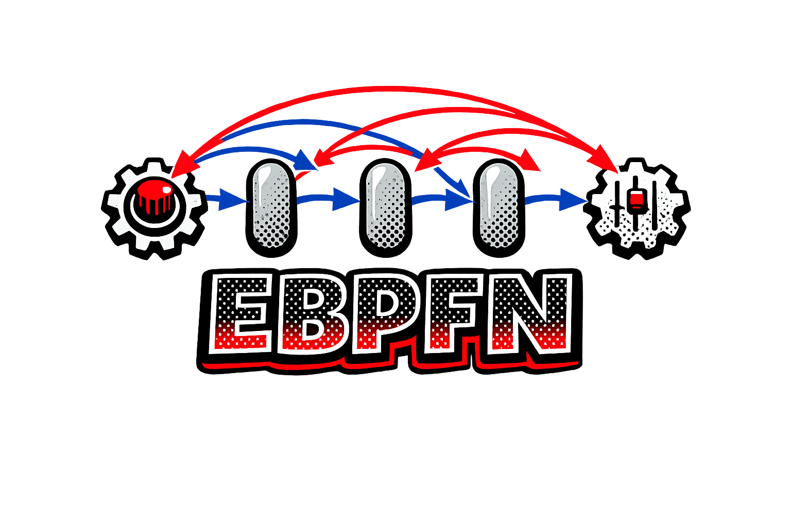

<p align="center">
  
</p>

# ebpfn

Empirical-Bayes PFN experiments for tabular regression.

The repository implements a staged system for adapting a hierarchical synthetic
regression-task prior to one supplied tabular dataset. The current implementation
provides strict configuration, deterministic random streams, leakage-safe source
splits, Polars task contracts, fixed-map regression characterization, and OpenML
ingestion at the benchmark boundary.

## Development

Install the Pixi environment:

```bash
pixi install
```

Run the acceptance checks:

```bash
pixi run lint
pixi run test
```

Prepare the configured OpenML source through the Hydra application boundary:

```bash
pixi run prepare-data
```

Run the deterministic Step 2 characterization smoke study:

```bash
pixi run characterize
```

Use `characterization_mode=audit` for the five-repeat evidence gate. An audit
remains `incomplete` until representative real-task repeats are supplied; its
validated row/feature applicability bounds are recorded explicitly. Study tables,
schemas, configuration, provenance, and decisions are written below
`benchmarks/results/characterization`.

The task generator is the vendored TabICLv2 prior (`ebpfn/priors/nanoprior`, see
NOTICE) under a tunable mechanism mixture `eta`. At the origin `eta` it reproduces
upstream's own mixture, which is the distribution the released checkpoint was
pretrained on — so the origin is the null arm every tuned variant is measured against.

OpenML acquisition needs network access the first time a task is cached under
`data/raw/openml`. Reusable package code does not import OpenML or Hydra.
